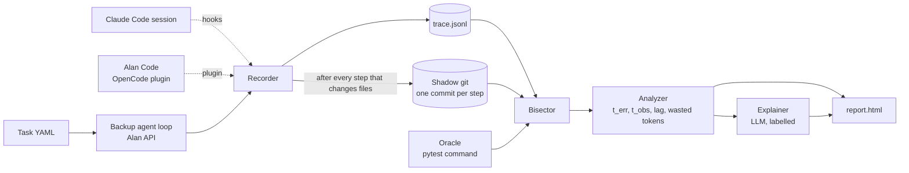

# AgentBisect

`git bisect` for coding agents. It finds the exact step where an agent broke your code, and how long the agent kept working before it noticed.

An agent works for 20 minutes, makes 30 edits, and the tests go red. You see only the last error. AgentBisect saves the repo after every agent action, then binary-searches those saves with your failing test.

```
╭────────────────────────────────── Verdict ───────────────────────────────────╮
│ Step 8 (edit shop/catalog.py) broke test_add_duplicate_raises.               │
│ The agent only noticed at step 11, so it spent 3 steps working on a broken   │
│ base. It spent 38k tokens after the break (57% of the run).                  │
╰──────────────────────────────────────────────────────────────────────────────╯
Probes (4, confidence 99.7%): 0:pass×3  12:fail×3  6:pass×4  8:fail×4
```

The verdict comes from running tests. No language model decides pass or fail. A model writes only an optional short note, always labelled "AI explanation".

Our research question: how many steps pass between the step that broke the code and the first step where the agent could see the failure? We call that the **detection lag**. The finding below measures it across open models.

## Quickstart

No API key needed.

```bash
git clone <this repo> && cd <this repo>
uv sync
uv run python -m agentbisect.synthetic make --out runs/try --steps 30 --break-at 9 --observe-at 21
uv run agentbisect run    --trace runs/try --check "python -m pytest -q tests/test_calc.py::test_add"
uv run agentbisect report --trace runs/try        # writes runs/try/report.html
```

Open `runs/try/report.html`. It is one file and works offline.

Real recorded runs go in `runs/demo/` (added with the study). Run the same way:
`uv run agentbisect run --trace runs/demo/<id>` with no `--check`. AgentBisect then finds every test that passed at the start and fails at the end, and bisects each one.

## What the report shows

- A banner with the decisive step, the failing test, the lag (or "never noticed") and the tokens spent after the break.
- A timeline of every step. The decisive step is red, the step where the agent first sees the failure is blue, and the steps between are shaded as "working on broken code".
- The diff of the decisive step, the agent's own words just before it, and the test output.
- The probe log: which steps the bisect tested, how many runs each took, and how sure it is.
- Optional "AI explanation" (`agentbisect report --explain`, needs credentials).

## How it works



1. **Record.** After each step that can change files (write, edit, shell), copy the repo into a shadow git repo. Your own `.git` is never touched. Steps that leave the files unchanged add no snapshot.
2. **Bisect.** The oracle (a pytest command) must pass at step 0 and fail at the last step. AgentBisect restores snapshots into a scratch folder, runs the oracle, and halves the range until it finds the first failing step. For 30 steps that takes at most 5 searches plus the two end checks.
3. **Measure.** `t_obs` is the first step at or after the decisive step whose tool output shows the same failure. `t_obs - t_err` is the lag. If no step shows it, the lag is censored: the agent never noticed.

Vocabulary: **trace** (the list of steps), **snapshot** (repo state after a step), **oracle** (the check command), **decisive step** (`t_err`), **observed step** (`t_obs`), **detection lag**, **wasted tokens** (tokens spent after `t_err`).

## The finding

*Comes after the study (M3). The numbers will come from `docs/RESULTS.md`: median detection lag per model with 95% intervals, the share of runs where the agent never noticed, the share of tokens wasted, and bisect accuracy on runs where we injected a known break.*

## Flaky tests and non-monotone histories

**Flaky tests.** If the test fails at random, one run per snapshot can mislead the search. AgentBisect runs the oracle 3 times at each end first. If all six runs agree, it treats the test as stable and uses one run per probe. If not, it measures the flip rate, then repeats each probe until a vote margin gives an error below a fixed budget. It refuses to bisect a test that flips more than 40% of the time. The maths is in `docs/METHODS.md`. In our tests the search still finds the right step when 10% of runs flip at random.

**Non-monotone histories.** Sometimes a test breaks, gets fixed, then breaks again. A plain binary search can land on any of the breaks. After the search, AgentBisect looks for two signs: the same repo state on both sides of the boundary, or a probe that fails before one that passes. If it sees either, it tests every step in order and lists every pass-to-fail change. The decisive step is the last one, since the final state still carries that break. The report flags this case.

## Known limitations

- Only files in the repo are captured. Packages installed system-wide and outside services are not.
- A step can be decisive only for a failure the oracle can detect. A bad choice that no test catches is invisible.
- Bisect assumes the oracle is deterministic enough. We handle flakiness with statistics. We do not remove it.
- A non-monotone history with no repeated repo state is not flagged as non-monotone. For example, the test breaks, an edit fixes it, and a later edit breaks it in a new way. The decisive step is still the last break.
- v1 supports Python and pytest only.
- The observed-step rule reads tool output. If the agent saw the failure in a way that left no trace in that output, we call the lag censored.

## Record your own runs

**Alan Code (the main way).** The agent under test is Alan Code, which is OpenCode inside the Alan app. You start it by hand and a plugin records every step. No API key is needed.

```bash
uv run agentbisect record --task tasks/t03.yaml --model flash
```

The command sets up the run and prints what to do:

1. Open the Alan app and start a conversation in the printed work folder.
2. Pick the model it names.
3. Paste the prompt (it is also saved in `runs/<id>/PROMPT.txt`).
4. Let the agent work until it stops.
5. Run `agentbisect run --trace runs/<id>`, then `agentbisect report --trace runs/<id>`.

**Claude Code.** A hook recorder turns a Claude Code session into the same trace format. See `docs/HOOKS.md`.

**Backup: our own agent loop.** If you have an Alan API key, `record --harness` runs a small agent loop of ours against the API.

```bash
cp .env.example .env     # fill in ALAN_BASE_URL and ALAN_API_KEY
uv run agentbisect record --task tasks/t01.yaml --model flash --harness
```

This spends credits. The command prints the model and the spend cap first, and `agentbisect/llm.py` stops all calls at `ALAN_SPEND_CAP_USD` (default 8.00). Model names and prices live in `tasks/models.yaml`. Tests never touch the network.

## Commands

```bash
agentbisect record --task tasks/t03.yaml [--model flash] [--harness]   # set up a run in Alan Code (or run our own loop)
agentbisect run    --trace runs/<id> [--check "<cmd>"]     # bisect; with no --check, find newly failing tests
agentbisect report --trace runs/<id> [--explain]           # write runs/<id>/report.html
agentbisect study  --suite tasks/ --models qwen,flash,glm,kimi --repeats 1   # batch runs and statistics (M3)
```

`run` exits 0 if it found a culprit and 1 if nothing could be bisected.

## Development

```bash
uv run pytest -q
uv run ruff check . && uv run ruff format --check .
```
