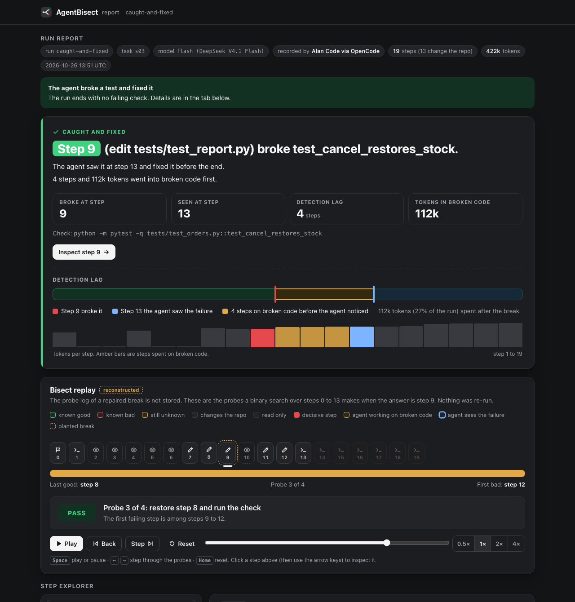
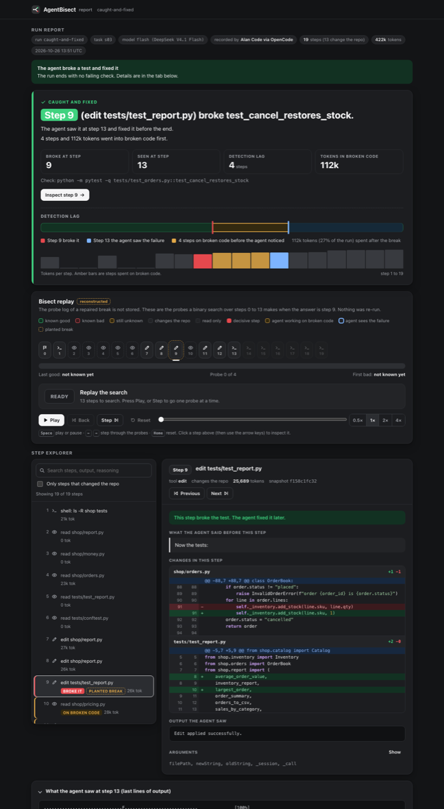
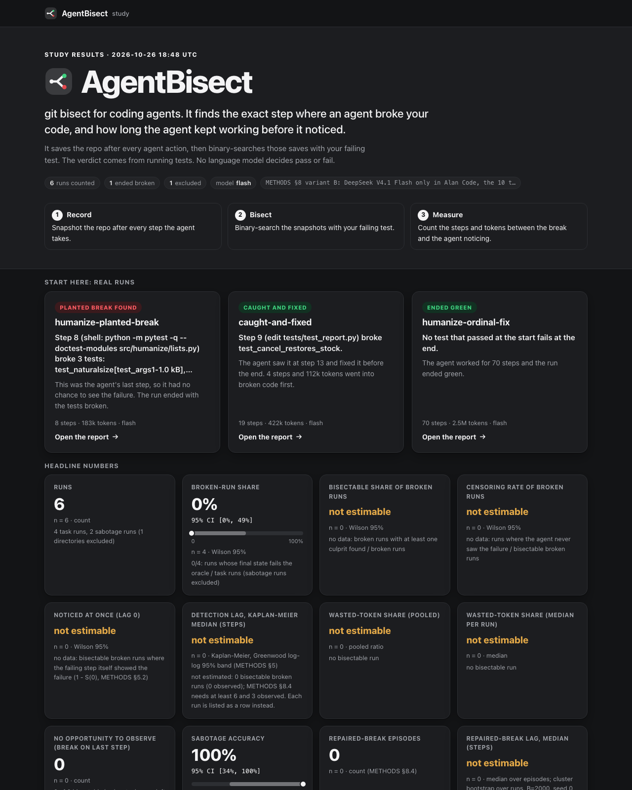
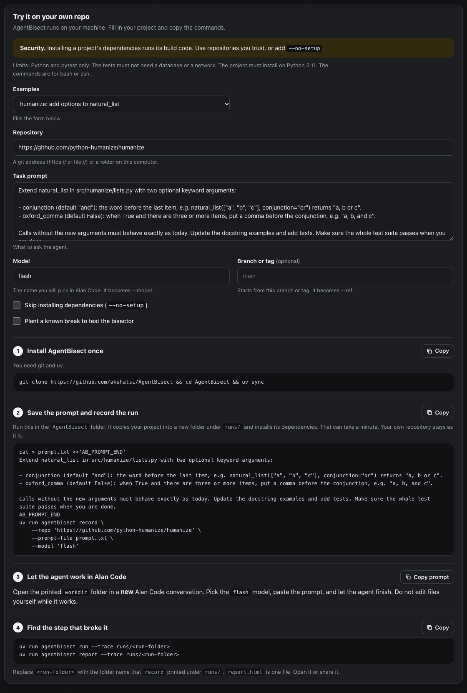
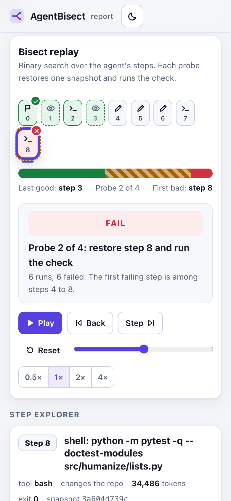
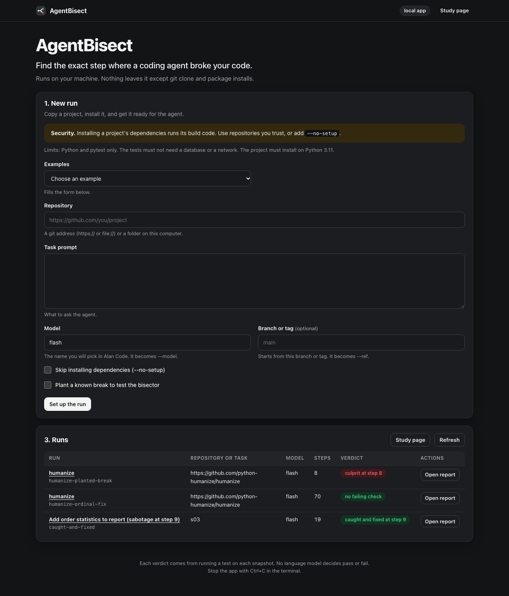
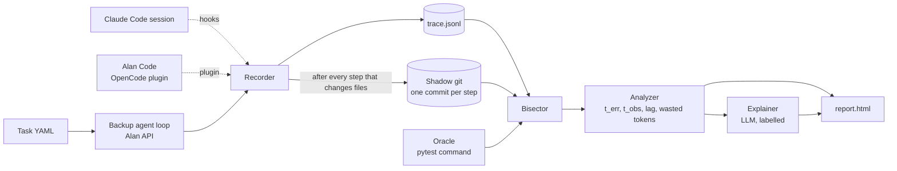

# AgentBisect

`git bisect` for coding agents. It finds the exact step where an agent broke your code, and how long the agent kept working before it noticed.

An agent works for 20 minutes, makes 30 edits, and the tests go red. You see only the last error. AgentBisect saves the repo after every agent action, then binary-searches those saves with your failing test.

Real output, from two runs shipped in `runs/demo/`. Both are real Alan Code runs of DeepSeek V4.1 Flash. The first is on a small practice repo (`caught-and-fixed`). The second is on [python-humanize/humanize](https://github.com/python-humanize/humanize) (`humanize-planted-break`).

```
$ uv run agentbisect run --trace runs/demo/caught-and-fixed
╭────────────────────────────── Caught and fixed ──────────────────────────────╮
│ Step 9 (edit tests/test_report.py) broke test_cancel_restores_stock.         │
│ The agent saw it at step 13 and fixed it before the end. 4 steps and 112k    │
│ tokens went into broken code first.                                          │
╰──────────────────────────────────────────────────────────────────────────────╯
```

```
$ uv run agentbisect run --trace runs/demo/humanize-planted-break
╭────────────────────────────────── Verdict ───────────────────────────────────╮
│ Step 8 (shell: python -m pytest -q --doctest-modules src/humanize/lists.py)  │
│ broke 3 tests: test_naturalsize[test_args1-1.0 kB],                          │
│ test_naturalsize[test_args2-1.0 kB], test_naturalsize[test_args56-1.0K].     │
│ This was the agent's last step, so it had no chance to see the failure. The  │
│ run ended with the tests broken.                                             │
╰──────────────────────────────────────────────────────────────────────────────╯
Probes, same for all 3 tests (4, confidence 99.7%): 0:pass×3  8:fail×6  5:pass
6:pass×4
```

In both runs we planted a known bug between the agent's steps, to check that bisect finds it. The verdict names the agent step whose snapshot first contains the bug, so the step label shows that step's own command, not the planted edit. Bisect named the planted step in both runs.

The verdict comes from running tests. No language model decides pass or fail. A model writes only an optional short note, always labelled "AI explanation".

Our research question: how many steps pass between the step that broke the code and the first step where the agent could see the failure? We call that the **detection lag**. The finding below measures it across open models.

## Screenshots

Each report is one HTML file that opens offline, with a replay of the search, a step-by-step inspector and a light and a dark theme. Press `Space` on a report to play the replay.



*The report for `humanize-planted-break`, three probes into the replay. Green steps pass, red steps fail, and the striped band is still unknown.*



*The inspector for the step that broke `test_cancel_restores_stock`: what the agent said, then the diff, with line numbers.*



*`runs/demo/study/study.html`: the landing page for the demo runs, then the numbers, the lag chart and the sortable table.*



*The command builder on the study page, filled with the `humanize` example: install, record, run the agent in Alan Code, then bisect and report.*



*The same replay at phone width.*

## Use it on your own project

Point AgentBisect at a Python project that has pytest tests. It copies the project, an agent works on the copy, and you bisect the result. Your original repo is not modified.

```bash
uv run agentbisect record --repo https://github.com/<you>/<project> \
    --prompt "Add retry with backoff to the HTTP client"
```

The study page (`runs/demo/study/study.html`) has a **Try it on your own repo** panel that writes these commands for you. You fill in the repository, the prompt and the model, and it prints each command, quoted for the shell, with a Copy button. It runs nothing and sends nothing.

`--repo` takes a git URL or a local path. Use `--prompt-file notes.txt` for a long prompt, `--ref <branch>` to start from a branch or tag, and `--model flash` to name the model you will pick.

1. `record` copies or clones the project into `runs/<id>/workdir` and installs its dependencies into a venv at `runs/<id>/venv`. If the install fails it prints the error and the path of `runs/<id>/setup.log`.
2. It then prints the work folder and your prompt. Open that folder in **Alan Code** (a new conversation), pick the model, paste the prompt, and let the agent work until it stops.
3. Bisect: `uv run agentbisect run --trace runs/<id>`. With no `--check`, it bisects every test that passed at the start and fails at the end. Pass `--check "python -m pytest -q tests/test_x.py::test_y"` to pick one.
4. Read the result: `uv run agentbisect report --trace runs/<id>` writes `runs/<id>/report.html`, one file that opens offline.

**Claude Code instead of Alan Code.** A hook recorder works in place on any repo, with no copy: install the hooks once, use Claude Code as usual, then run steps 3 and 4 on the `runs/cc-<session>` folder it writes. See `docs/HOOKS.md`.

**Security note.** Installing a project's dependencies runs its build code (`setup.py`, build backends, install scripts). Use `record --repo` on projects you trust, or pass `--no-setup` to skip the install and use AgentBisect's own interpreter. The agent itself also runs commands on your machine, as it does in any Alan Code or Claude Code session.

## Local app

`uv run agentbisect serve` opens a page in your browser that does the setup and the bisect for you. Fill in a repository, a prompt and a model, and the page clones the project, installs it and records step 0. It then shows the run folder and the prompt, each with a Copy button. When the agent has finished, press **The agent has finished: find the step**. The page bisects the run and links to the report. A table lists every run, and links to the study page.



After you press **Set up the run**, a next-step card shows the run folder and the prompt, each with a Copy button.

It cannot start the agent. You open the run folder in a new Alan Code conversation, paste the prompt and let the agent work. The app runs on `127.0.0.1` only, takes an access token from the link it prints, and sends nothing off your machine except `git clone` and package installs. The page is one offline file. Cloning and installing run the project's build code, so use repositories you trust.

## Quickstart with no API key

The repo ships real recorded runs in `runs/demo/`. You need no API key and no agent. You need [uv](https://docs.astral.sh/uv/) and git.

```bash
git clone https://github.com/akshatsi/Breaking-Point && cd Breaking-Point
uv sync
uv run agentbisect run    --trace runs/demo/caught-and-fixed          # prints the verdict above
uv run agentbisect report --trace runs/demo/humanize-planted-break    # writes runs/demo/humanize-planted-break/report.html
uv run agentbisect study  --runs runs/demo                            # statistics over all 6 counted runs
```

`report` writes `report.html` inside the trace folder and prints a `file://` link. It is one file and opens offline. Each demo folder already holds a prebuilt `report.html`, so you can open it without running anything. `study` also writes `runs/demo/study/study.html`, `study.json` and `RESULTS.draft.md`.

Run `agentbisect run --trace runs/demo/<id>` on the other folders the same way: `humanize-ordinal-fix`, and the four task runs `t01-…`, `t06-…`, `t08-…`, `t10-…`. With no `--check`, AgentBisect finds every test that passed at the start and fails at the end, and bisects each one.

## What the report shows

`agentbisect report` writes one interactive HTML file. It opens offline, with no server and no network.

- **Verdict:** the decisive step, the failing tests (grouped by step), the lag or "never noticed", and the tokens spent after the break.
- **Bisect replay:** press Play and watch the search. Each probe restores one snapshot and runs your test. The good/bad range shrinks until it lands on the culprit. Space plays, the arrow keys step.
- **Step explorer:** click any step for the agent's reasoning, tool call, output, tokens, and a coloured diff of what that step changed. Search the trace, or show only steps that changed the repo.
- **Detection lag:** steps and tokens between the break and the moment the agent saw it.
- **Caught and fixed:** runs where the agent broke a test, saw it fail and fixed it before the end.
- **Probe log and confidence:** which steps were tested and how sure the verdict is.
- Optional "AI explanation" (`agentbisect report --explain`, needs credentials). It is labelled and never decides pass or fail.

`agentbisect study --runs runs/demo` writes `runs/demo/study/study.html`, a landing page with the headline numbers and a card for each demo run.

## How it works



1. **Record.** After each step that can change files (write, edit, shell), copy the repo into a shadow git repo. Your own `.git` is never touched. Steps that leave the files unchanged add no snapshot.
2. **Bisect.** The oracle (a pytest command) must pass at step 0 and fail at the last step. AgentBisect restores snapshots into a scratch folder, runs the oracle, and halves the range until it finds the first failing step. For 30 steps that takes at most 5 searches plus the two end checks.
3. **Measure.** `t_obs` is the first step at or after the decisive step whose tool output shows the same failure. `t_obs - t_err` is the lag. If no step shows it, the lag is censored: the agent never noticed.

Vocabulary: **trace** (the list of steps), **snapshot** (repo state after a step), **oracle** (the check command), **decisive step** (`t_err`), **observed step** (`t_obs`), **detection lag**, **wasted tokens** (tokens spent after `t_err`).

## The finding

Full numbers and method: [`docs/RESULTS.md`](docs/RESULTS.md) (audited by recomputing every count and interval from the run files). The setup is small. One model (DeepSeek V4.1 Flash) in Alan Code, run by hand, on a practice repo and on humanize. The plan had 19 runs; we stopped after 6 counted runs: 4 task runs and 2 planted-break runs.

| Metric | Value | 95% interval | n |
|---|---|---|---|
| Task runs that ended with a failing test | 0 of 4 | 0%–49% | 4 |
| Planted breaks where bisect named the planted step | 2 of 2 | 34%–100% | 2 |
| Detection lag, share that never noticed, tokens after the break | not estimable | – | 0 |

The lag statistics need broken runs, and no task run ended broken. So this study does not yet answer the research question.

**Simulation, not real agent runs.** On 3,000 simulated 30-step histories, bisect named the wrong step in 0% of runs with a deterministic oracle, and in 1.1% when 10% of oracle runs flip at random (2.9% at 20%, with 4.0% refused as not bisectable).

**Case study 1: practice repo, planted break (`caught-and-fixed`).** We planted a bug at step 9: cancelling an order restocks 1 unit, not the ordered quantity. The agent's own `pytest` at step 13 showed the failure, a lag of 4 steps and 112,179 tokens (27% of the run). It reverted the file at step 18 and the run ended green. Caveat: the agent found the plant with `git diff`. An agent hunting its own bug has no such help, so this lag may be shorter than an organic one.

**Case study 2: humanize, planted break.** We planted a bug in `src/humanize/filesize.py` at step 8, the agent's last step. Auto-oracle found 3 newly failing tests and bisect named step 8 for each. The agent had no chance to see it, so the run counts for bisect accuracy only.

**What we cannot claim.** How often agents break code. How long agents take to notice in general. How many tokens they waste. Anything about other models: we ran one. Four runs with no organic break support no such number.

**What we learned building it.** One real task on humanize (70 steps, run ended green, not counted in the metrics) exposed three bugs in AgentBisect, now fixed: pytest colour codes hid every result line, snapshots dropped humanize's git-ignored generated `_version.py`, and editable installs let the oracle test the agent's working copy, not the snapshot.

## Flaky tests and non-monotone histories

**Flaky tests.** If the test fails at random, one run per snapshot can mislead the search. AgentBisect runs the oracle 3 times at each end first. If all six runs agree, it treats the test as stable and uses one run per probe. If not, it measures the flip rate, then repeats each probe until a vote margin gives an error below a fixed budget. It refuses to bisect a test that flips more than 40% of the time. The maths is in `docs/METHODS.md`. In our tests the search still finds the right step when 10% of runs flip at random.

**Non-monotone histories.** Sometimes a test breaks, gets fixed, then breaks again. A plain binary search can land on any of the breaks. After the search, AgentBisect looks for two signs: the same repo state on both sides of the boundary, or a probe that fails before one that passes. If it sees either, it tests every step in order and lists every pass-to-fail change. The decisive step is the last one, since the final state still carries that break. The report flags this case.

## Known limitations

- Only files in the repo are captured. Packages installed system-wide and outside services are not.
- A step can be decisive only for a failure the oracle can detect. A bad choice that no test catches is invisible.
- Bisect assumes the oracle is deterministic enough. We handle flakiness with statistics. We do not remove it.
- A non-monotone history with no repeated repo state is not flagged as non-monotone. For example, the test breaks, an edit fixes it, and a later edit breaks it in a new way. The decisive step is still the last break.
- v1 supports Python and pytest only.
- Projects whose tests need services or databases (Postgres, Redis, a network) will not work: the oracle runs the tests in a bare scratch folder with no services.
- Dependency install must succeed. If the project cannot install into a fresh venv, `record --repo` stops with the log. `--no-setup` skips it, but then the tests must run on AgentBisect's interpreter.
- The observed-step rule reads tool output. If the agent saw the failure in a way that left no trace in that output, we call the lag censored.

## Recording details

**Alan Code with a task (the main way for the study).** The agent under test is Alan Code, which is OpenCode inside the Alan app. You start it by hand and a plugin records every step. No API key is needed.

```bash
uv run agentbisect record --task tasks/t03.yaml --model flash
```

`record --task` copies a fixture repo from `tasks/` instead of your project. It sets up the run and prints what to do:

1. Open the Alan app and start a **new** conversation in the printed work folder. Use one new conversation per run. If Alan resumes an earlier conversation, `agentbisect run` warns and the study excludes that run.
2. Pick the model it names.
3. Paste the prompt (it is also saved in `runs/<id>/PROMPT.txt`).
4. Let the agent work until it stops.
5. Run `agentbisect run --trace runs/<id>`, then `agentbisect report --trace runs/<id>`.

**Claude Code.** A hook recorder turns a Claude Code session into the same trace format. See `docs/HOOKS.md`.

**Backup: our own agent loop.** If you have an Alan API key, `record --harness` runs a small agent loop of ours against the API.

```bash
cp .env.example .env     # fill in ALAN_BASE_URL and ALAN_API_KEY
uv run agentbisect record --task tasks/t01.yaml --model flash --harness
```

This spends credits. The command prints the model and the spend cap first, and `agentbisect/llm.py` stops all calls at `ALAN_SPEND_CAP_USD` (default 8.00). Model names and prices live in `tasks/models.yaml`. Tests never touch the network.

## Commands

```bash
agentbisect record --task tasks/t03.yaml [--model flash] [--harness]   # set up a run in Alan Code (or run our own loop)
agentbisect record --repo <path|url> --prompt "..." [--ref B] [--no-setup]   # same, on your own project
agentbisect run    --trace runs/<id> [--check "<cmd>"]     # bisect; with no --check, find newly failing tests
agentbisect report --trace runs/<id> [--explain]           # write runs/<id>/report.html
agentbisect study  [--runs runs] [--rebisect] [--models flash]   # add up recorded runs: statistics, study.html, RESULTS.draft.md
```

`run` exits 0 if it found a culprit and 1 if nothing could be bisected. `study` exits 1 when the runs folder holds no usable run. It never starts an agent: you record runs by hand, then `study` adds them up. `--models` keeps only runs of the given model aliases, and `--suite tasks/` keeps only tasks that have a YAML there. `--rebisect` bisects every run again instead of reusing its `bisect.json`.

## Development

```bash
uv run pytest -q
uv run ruff check . && uv run ruff format --check .
```
