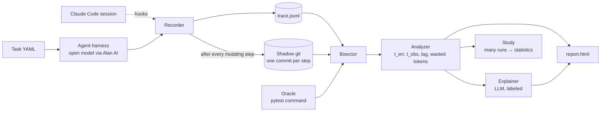

# Architecture — AgentBisect

## One-paragraph summary

AgentBisect records a snapshot of the repo after every action a coding agent takes. When the final state fails a
test, it binary-searches those snapshots, running the test on each, to find the **one step** that broke it.
It then checks when the agent first *saw* the failure. The gap between the two is the **detection lag**, our
measure of how long agents keep working on broken code without knowing.

## Flow



## Components

| # | Module | Input | Output | Deterministic? |
|---|---|---|---|---|
| 1 | `harness/agent.py` | task YAML, Alan model | an agent run with tools `read_file`, `write_file`, `edit_file`, `run_shell`, `finish` | No (it's the agent under test) |
| 2 | `hooks/claude_code.py` | Claude Code PostToolUse hook events | the same trace format | Yes |
| 3 | `snapshot.py` | workdir after a step | shadow-git commit SHA (deduped by tree hash) | Yes |
| 4 | `models.py` | — | `Step`, `Trace`, `OracleResult`, `BisectResult`, `CulpritReport`, `StudyRow` | — |
| 5 | `oracle.py` | snapshot SHA, check command | pass, fail, or error, with exit code, duration and output tail; repeated runs per `METHODS.md` | Yes |
| 6 | `bisect.py` | trace, oracle | decisive step, plus a "non-monotone" flag if the history flips | Yes |
| 7 | `analyze.py` | trace, decisive step | `t_obs`, lag (or censored), wasted tokens | Yes |
| 8 | `explain.py` | step diff, reasoning, oracle output | ≤120-word explanation, labeled "AI explanation" | No (cosmetic only) |
| 9 | `report/` | culprit report | one static `report.html` | Yes |
| 10 | `study.py` + `stats.py` | many runs | results table, lag distribution, confidence intervals | Yes |

## Key design decisions

1. **Shadow git, not the user's git.** Snapshots never touch the user's history. Each mutating step adds one
   commit, and identical trees are deduped, so bisect runs over distinct states only.
2. **Snapshot after every shell call, not just file edits.** Agents mutate files with `sed`, formatters, and
   codegen. Read-only steps (e.g. `read_file`) produce no snapshot.
3. **Auto-oracle.** If no `--check` is given, run the full suite at step 0 and at the final step. Every test that
   passed at the start and fails at the end is bisected **separately**, since different tests can break at
   different steps. This "multi-culprit" output is one of our differentiators.
4. **Preconditions are checked, not assumed.** The oracle must pass at step 0 and fail at the final step.
   Otherwise we report "not bisectable" with the reason.
5. **Flaky oracles are handled with math, not hope.** Repeat counts and decision rules come from
   `docs/METHODS.md` (owned by math-analyst).
6. **Non-monotone histories are detected.** If a test breaks, gets fixed, then breaks again, we report every
   pass→fail transition (using a linear confirmation scan when bisect finds a non-monotone history).
7. **Observed step rule (deterministic).** `t_obs` is the first step ≥ `t_err` whose tool output contains a failure
   signal for the same test: a non-zero pytest exit that mentions the test ID, or a traceback from a file the
   culprit diff touched. If no such step exists, the lag is **censored** (the agent never noticed).
8. **LLM is cosmetic.** The explanation can be wrong, and the verdict can't be affected by it.

## Model usage (Alan AI)

- `llm.py` is a single OpenAI-compatible client configured by env vars:
  `ALAN_BASE_URL`, `ALAN_API_KEY`, `ALAN_MODEL`, `ALAN_SPEND_CAP_USD`.
- **Verify Alan's endpoint format when access arrives**, then update this section. If Alan's API isn't
  OpenAI-compatible, write a thin adapter in `llm.py` only.
- If the chosen model doesn't support native tool calls, the harness falls back to a JSON action protocol
  (`{"tool": ..., "args": ...}` in a fenced block).
- `FakeLLM` replays recorded responses for tests and costs nothing.

### Model roles (models available on Alan AI)

| Role | Model | Why |
|---|---|---|
| Smoke tests and harness development | Nemotron 3.5 Lightning or Nemotron 3 Nano | Cheapest and fastest; it only needs to drive the loop. |
| Explainer (`explain.py`) | Nemotron 3.5 Lightning | Cosmetic, ≤120 words. Never affects the verdict. |
| Agent under test: small | Qwen3.8 27B | Smallest model, likely to break things often. |
| Agent under test: fast | DeepSeek V4.1 Flash (default `ALAN_MODEL`) | The likely everyday choice. |
| Agent under test: mid | GLM 5.3 | A different model family, so the finding isn't specific to one lab. |
| Agent under test: large | Kimi K3 | Tests whether stronger models notice their own mistakes sooner. |
| Spares (swap in if a primary fails the probe or costs too much) | MiniMax M3, DeepSeek V4 Pro, Nemotron 3 Ultra, MiniMax M3.1 Flash, GLM 5.3 Flash | Ready replacements, no re-planning needed. |

Not planned: Muse Spark 1.3, 1.3 Contributor and 1.2 Contributor. The kit has no information on what the
"Contributor" variants are, so they are used only if the probe shows they work, and then only as spares.

The study compares detection lag **across models**, which makes the finding comparative: "does a bigger model
notice it broke the code sooner?" Before the study, `harness-builder` runs one probe call per model to confirm
the API model ID, tool-call support, and cost per 1k tokens, and records them in `docs/DECISIONS.md`. The final
lineup comes from that probe: keep a primary only if tool calls work and one task costs well under the per-run
budget (spend cap ÷ planned runs). Replace failures from the spares row. Model aliases and their API IDs live in
`tasks/models.yaml`, so swapping a model never touches code.

## Known limitations (state these openly in the README)

- Only state inside the repo is captured. Packages installed globally or external services are not.
- A step can be "decisive" only for failures the oracle can detect. Bad decisions that no test catches are invisible.
- Bisect assumes the oracle is deterministic enough. Flakiness is handled statistically, not eliminated.
- v1 supports Python and pytest only.

## Repo layout

```
agentbisect/
  cli.py  models.py  llm.py  snapshot.py  oracle.py  bisect.py  analyze.py  explain.py  study.py  stats.py
  harness/agent.py  harness/tools.py
  hooks/claude_code.py
  report/template.html.j2  report/render.py
tasks/            # task YAMLs plus the target repo fixture
runs/             # outputs (gitignored except demo runs)
tests/            # unit tests; tests/acceptance/ owned by verifier
docs/ ARCHITECTURE.md  METHODS.md  DECISIONS.md  PROGRESS.md  RESULTS.md
```
